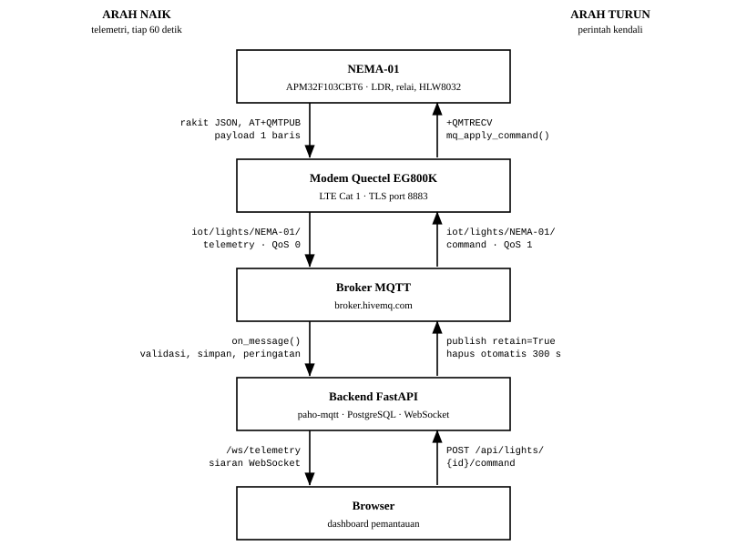

# 1. Arsitektur



## 1.1 Lingkup pekerjaan

Board NEMA ini aslinya mengirim data ke web milik pembuat board, dan pemakai
hanya bisa melihat apa yang disediakan web itu. Pekerjaan di sini memindahkan
aliran datanya: firmware diarahkan ke broker MQTT dan backend yang dibangun
sendiri, sehingga format payload, basis data, aturan peringatan, dan tampilan
dashboard sepenuhnya di tangan sendiri.

Pengujian seluruh rantai dilakukan di meja kerja. Controller duduk di soket
NEMA dan menyalakan satu luminaire, belum dipasang di tiang lampu jalan.
Koordinat yang tersimpan di flash karena itu masih koordinat titik uji, bukan
titik tiang sebenarnya.

## 1.2 Lima lapisan sistem

| Lapisan | Perangkat / proses | Peran |
|---|---|---|
| Controller | Board NEMA `NEMA-01`, APM32F103CBT6 | Membaca LDR dan meter daya, menyalakan relai, mengatur kecerahan |
| Radio | Modem Quectel EG800K, LTE Cat 1 | Menyambung ke broker lewat TLS di port 8883 |
| Perantara | `broker.hivemq.com` | Menampung dan meneruskan pesan kedua arah |
| Server | Backend FastAPI, PostgreSQL | Memvalidasi, menyimpan, menilai peringatan, broadcast ke browser |
| Tampilan | Dashboard di browser | Menampilkan status dan mengirim perintah |

## 1.3 Board dan backend terhubung lewat broker

Keduanya menyambung ke broker, dan broker yang meneruskan. Dengan pemisahan
ini, satu alamat IP publik cukup untuk melayani board di balik NAT operator
seluler, tanpa port forwarding dan tanpa alamat tetap di sisi board.

Akibatnya, status "NEMA terhubung ke backend" terdiri atas dua jalur, dan
masing-masing bisa gagal sendiri.

```text
board  --(telemetri)-->  broker  --(telemetri)-->  backend --> dashboard
board  <--(perintah)---  broker  <--(perintah)---  backend <-- dashboard
```

Dashboard yang menampilkan angka terbaru hanya membuktikan arah naik hidup.
Arah turun tidak bisa dibuktikan dari layar. Alat
`python-backend/tools/cek_nema.py` menguji keduanya, lihat subbab 8.1.

## 1.4 Arah naik: telemetri dari board

1. Board merakit satu baris JSON berisi tegangan, arus, daya, kecerahan,
   status relai, mode otomatis, koordinat, dan uptime.
2. Board menerbitkannya lewat `AT+QMTPUB` ke `iot/lights/NEMA-01/telemetry`,
   QoS 0, tiap 60 detik.
3. Backend subscribe ke `iot/lights/+/telemetry` dengan QoS 1. `_on_message()`
   memvalidasi `device_id` terhadap tabel `devices`, menolak total kalau tidak
   terdaftar, lalu menyimpan ke `telemetry_logs` dan memperbarui `devices`.
4. Backend broadcast hasilnya ke semua dashboard lewat `/ws/telemetry`.

Selama mode otomatis menggerakkan kecerahan, board mempercepat laporan sampai
sekali per 10 detik, lalu kembali ke 60 detik begitu kecerahannya tenang. Jeda
yang terukur pada pengujian: 10,1 detik, 9,9 detik, dan 10,4 detik, lalu
kembali ke 68,7 detik.

## 1.5 Arah turun: perintah ke board

1. Dashboard mengirim `POST /api/lights/{device_id}/command` dengan token sesi
   admin di header `X-ACW-Token`.
2. Backend publish payload JSON ke `iot/lights/{device_id}/command` dengan
   QoS 1 dan `retain=True`.
3. Board menerimanya sebagai `+QMTRECV`, menjalankannya di `mq_apply_command()`,
   lalu melaporkan status barunya segera tanpa menunggu giliran 60 detik.
4. Backend menghapus retained message itu setelah 300 detik.

Waktu tanggap yang terukur saat sambungan sehat: 0,7 sampai 0,8 detik dari
penekanan tombol sampai telemetri balasan tiba.

## 1.6 Alasan perintah dikirim sebagai retained message

Modem di jaringan seluler kehilangan sesi tanpa pemberitahuan. Perintah QoS 1
ke klien yang sedang putus akan hilang kalau broker tidak menyimpannya.
`retain=True` membuat broker menahan pesan terakhir di topik itu dan
mengirimkannya begitu board subscribe lagi.

Pilihan itu punya risiko, dan risiko itu pernah terjadi: perintah
`{"relay":"off"}` yang tertinggal di broker memadamkan lampu setiap kali board
menyambung ulang, berhari-hari setelah tombolnya ditekan. Karena itu backend
menghapus retained message setelah `RETAINED_COMMAND_TTL_SECONDS` (300 detik),
dan menyapu sisa perintah yatim di `_on_connect()` setiap kali backend hidup.

## 1.7 Struktur folder

```text
Smart-Lamp-System-ACW/
├── firmware/                     salinan proyek STM32CubeIDE board NEMA
│   └── Core/Src/main.c           seluruh logika board, 4.362 baris
├── python-backend/               FastAPI, ingest MQTT, akses PostgreSQL
│   ├── main.py                   entrypoint, /health, /ws/telemetry
│   ├── mqtt_ingest.py            langganan, validasi, siaran, penerbit perintah
│   ├── db.py                     seluruh kueri SQL
│   ├── routes_*.py               endpoint REST per bidang
│   ├── schema.sql                bentuk tabel
│   └── tools/                    cek_nema.py, simulate_light.py, jembatan serial
├── Dashboard_Monitoring/         frontend statis, tanpa framework
│   ├── index.html                lima halaman dalam satu berkas
│   ├── script.js                 3.946 baris
│   └── style.css
├── document/                     dokumentasi ini
├── docs/                         laporan teknis PDF dan sumbernya
├── run-dashboard-windows.bat     menjalankan seluruh tumpukan di Windows
└── cek-sistem-windows.bat        memeriksa tumpukan yang sedang berjalan
```
