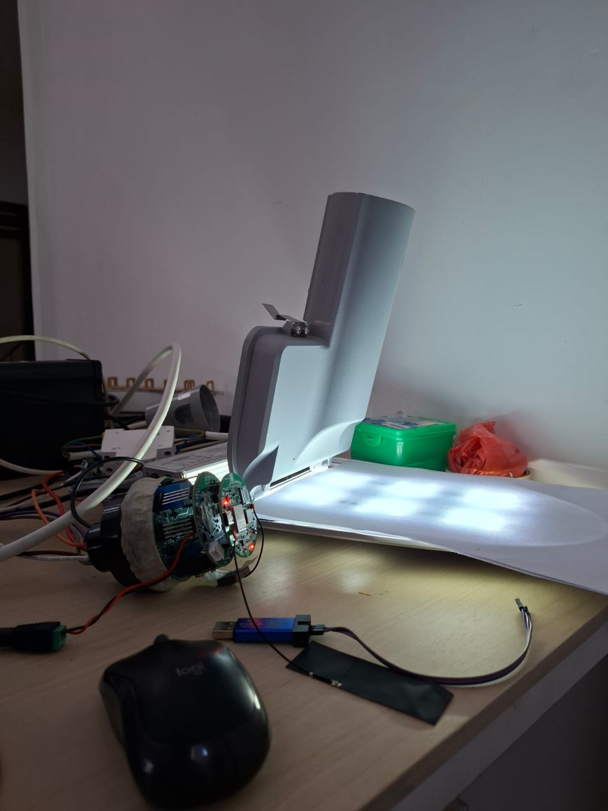
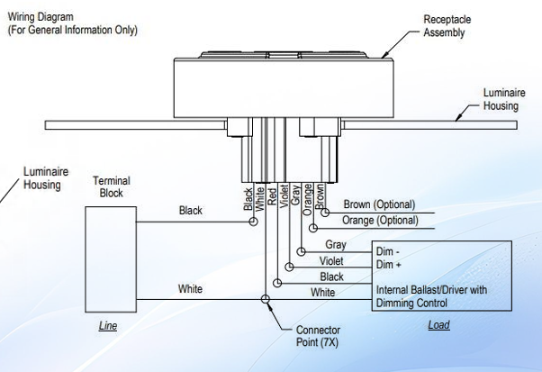

# 2. Firmware board NEMA

Sumber: `firmware/Core/Src/main.c`, 4.362 baris. Proyek STM32CubeIDE dengan HAL
STM32F1xx. Build bersih terakhir memakai 55.180 byte flash dari 127 KB
(42,43 %) dan 4.808 byte RAM dari 20 KB (23,48 %).





## 2.1 Mikrokontroler

APM32F103CBT6, klon Geehy dari STM32F103CB. Toolchain, HAL, dan skrip linker
STM32 dipakai apa adanya. Perbedaannya hanya terasa di sisi debugger: OpenOCD
butuh berkas konfigurasi sendiri, `firmware/openocd_apm32.cfg`.

Clock 72 MHz dari kristal luar lewat PLL.

## 2.2 Peta pin

| Pin | Fungsi | Catatan |
|---|---|---|
| PB0 | LDR, ADC1 kanal 8 | Pembacaan mentah 0 sampai 4095 |
| PB1 | PWM dimmer, TIM3 kanal 4 | 200 Hz, ARR 3599 |
| PA15 | Relai lampu | Aktif rendah: `GPIO_PIN_RESET` menyalakan lampu |
| PB13 | Power factor dari meter daya | Diukur sebagai periode dan beda fasa |
| PB8 | LED heartbeat | Aktif rendah |
| PB9 | LED status lampu | Aktif rendah |
| PB6, PB7 | I2C1 | SHT30 di 0x44, RTC di 0x32, akselerometer di 0x19 |
| PA9, PA10 | USART1, meter daya HLW8032 | 4800 8N1, modul bicara sendiri tanpa diminta |
| PA2, PA3 | USART2, modem Quectel EG800K | 115200 8N1 |
| PB10, PB11 | USART3, GPS | 115200 8N1 |

### Pembagian tiga UART untuk empat perangkat saat debug

Board punya tiga UART dan empat perangkat yang menginginkannya: konsol, modem
4G, GPS, dan meter daya. Meter memegang USART1 selamanya. Modem terpasang mati
di PA2/PA3 dan GPS di PB10/PB11, keduanya soket fisik yang tidak bisa ditukar
lewat program. Konsol harus menumpang salah satunya, dan yang ditumpangi
kehilangan perangkatnya.

Saklarnya `#define MODEM_BRINGUP` di `main.c`:

| Nilai | Konsol | Modem | GPS |
|---|---|---|---|
| `1` | PB10/PB11, colok USB-TTL ke soket GPS | Hidup di PA2/PA3, perintah `at...` diteruskan | Mati, letak tiang dibaca dari flash |
| `0` | PA2/PA3 | Mati | Hidup di PB10/PB11 |

Build yang ada di repo memakai `MODEM_BRINGUP 1`. Nilai itu dipakai selama
menyiapkan jalur 4G, supaya modem bisa diajak bicara sambil jawabannya terlihat.

## 2.3 Dimmer

Tingkat kecerahan disimpan dalam per mille, 0 sampai 1000.
`dim_set_permille()` mengubahnya jadi nilai pembanding TIM3 dan menulisnya ke
CCR4.

Frekuensi PWM 200 Hz dipilih berdasarkan pengukuran. Tingkat 0-10 V di board NEMA
dikopel optik dan tidak sanggup mengikuti PWM cepat. Pengukuran pada setengah
duty: 20 kHz menghasilkan 37 mV alih-alih 5 V, 1 kHz menghasilkan 4,77 V,
sedangkan 200 Hz dan 100 Hz sama-sama 5,01 V. Jadi 200 Hz adalah frekuensi tertinggi
yang masih diikuti dengan tepat.

Dua pengubah tersedia lewat konsol: `g` memilih kurva linear atau kuadrat, dan
`i` membalik arah duty di PB1 terhadap permintaan.

## 2.4 Mode otomatis LDR

Saat `dim_auto` menyala, LDR yang menentukan kecerahan dan permintaan dim
ditolak, baik dari konsol maupun dari dashboard. Board tidak bergantung pada
dashboard yang sudah mematikan slidernya, karena perintah bisa datang dari
klien mana pun yang tahu nama topiknya.

Dua titik acuan menentukan pemetaan:

| Variabel | Bawaan | Arti |
|---|---|---|
| `ldr_day` | 200 | Pada nilai ini ke bawah, lampu gelap |
| `ldr_night` | 2000 | Pada nilai ini ke atas, lampu penuh |

Di antara keduanya kecerahan diinterpolasi. Perubahan dibatasi `AUTO_STEP`
(20 per mille per detik) supaya lampu tidak berkedip saat awan lewat, sehingga
satu sapuan penuh memakan sekitar lima puluh detik.

## 2.5 Meter daya

HLW8032 di USART1 mengirim frame 24 byte terus-menerus pada 4800 8N1.
`meter_frame_byte()` memakai sliding window dan memeriksa checksum, lalu
`meter_decode()` menghitung tegangan, arus, dan daya dari koefisien modul.

Dua perintah kalibrasi tersedia: `ci <mA>` menyamakan pembacaan arus dengan
tang amper, dan `cw <W>` menyamakannya dengan daya dinding yang diketahui saat
lampu menyala. Hasilnya masuk ke flash lewat `save`.

Pembacaan yang lebih tua dari `METER_STALE_MS` (2000 ms) dianggap basi dan
tidak ikut dilaporkan. Tegangan di bawah `MAINS_MIN_V` (50 V) dibaca sebagai
input menganggur, bukan sebagai pengukuran.

## 2.6 Penyimpanan di flash

Satu halaman di `0x0801FC00` menyimpan struktur `cfg_t` versi 4: koefisien
tegangan dan arus meter, vektor gravitasi acuan untuk deteksi kemiringan, serta
koordinat tiang. Keutuhannya dijaga magic `NEMA` (0x414D454E) dan penjumlahan
seluruh field.

Koordinat disimpan karena tiang lampu tidak berpindah. Menyimpan koordinat
sekali lebih andal daripada meminta posisi ke GPS tiap boot: cold start di bawah
atap bisa memakan seperempat jam atau tidak pernah selesai, dan jawabannya akan
sama setiap kali. Fix yang kemudian berbeda jauh justru berarti tiangnya
dipindah atau unitnya dicuri.

## 2.7 State machine MQTT

`mqtt_service()` menjalankan rantai perintah AT tanpa blocking. Tiap langkah
punya batas waktu sendiri, dan `mq_go()` mencetak transisi state ke konsol
saat `mq_verbose` menyala.

| State | Yang dikerjakan |
|---|---|
| `boot` | Memberi modem waktu menyala |
| `ping` | `AT`, memastikan modem menjawab |
| `net` | Menunggu `+CEREG` melaporkan sudah terdaftar |
| `radio` | Mengirim `AT+CFUN=1` kalau radio ternyata mati |
| `apn` | Menyetel APN |
| `pdp` | Mengaktifkan konteks data |
| `pdp?` | Memastikan konteksnya benar-benar aktif |
| `ssl` | Menyetel TLS, empat langkah termasuk `AT+QMTCFG="session",0,1` |
| `close` | Melepas sesi lama |
| `settle` | Memberi modem waktu melepas soketnya |
| `open` | `AT+QMTOPEN` ke broker |
| `conn` | `AT+QMTCONN`, mendaftar sebagai klien MQTT |
| `sub` | `AT+QMTSUB` ke topik perintah, QoS 1 |
| `idle` | Siap, menunggu giliran publish |
| `prompt` | Menunggu tanda `>` dari modem |
| `ack` | Menunggu `+QMTPUB` |
| `wait` | Jeda `MQTT_RETRY_MS` setelah gagal |

Tiap perintah AT berakhir dengan `OK` atau `ERROR`. Pesan di antaranya, seperti
`+CEREG: 0,1`, hanya data. Transisi state menunggu penutupnya. Versi lama
yang berpindah begitu data itu terlihat membuat seluruh rantai bergeser satu
langkah, dan `ERROR` milik satu perintah terbaca sebagai kegagalan perintah
lain.

### Konstanta konfigurasi

| Tetapan | Nilai | Arti |
|---|---|---|
| `MQTT_BROKER_HOST` | `broker.hivemq.com` | Nama domain, bukan IP |
| `MQTT_BROKER_PORT` | 8883 | TLS |
| `MQTT_CLIENT_ID` | `nema01sultan2026` | |
| `MQTT_PERIOD_MS` | 60000 | Jeda telemetri normal |
| `MQTT_RETRY_MS` | 20000 | Jeda setelah gagal |
| `MQTT_AUTO_MIN_MS` | 10000 | Laporan cepat tidak lebih rapat dari ini |
| `MQTT_AUTO_DELTA` | 30 | Per mille, 3 %, ambang "kecerahan masih bergerak" |

### Alamat broker berupa nama domain

Alamat broker sebelumnya dipaku sebagai `18.153.87.221`, satu node publik
HiveMQ yang kebetulan terpakai. Pada 21 Oktober 2026 node itu berhenti
menjawab sama sekali: ping mati, port 1883 dan 8883 tertutup, sementara nama
domainnya menunjuk ke node lain yang sehat. Dengan IP yang dipaku,
pergantian itu menuntut board di-flash ulang. Dengan nama domain, modem yang
menyelesaikan DNS-nya sendiri lewat konteks data dan board ikut berpindah tanpa
disentuh. `AT+QMTOPEN` menerima nama domain apa adanya.

### Pemilihan port 8883

Port polos ditolak di sebagian kumpulan alamat yang diberikan operator. TCP-nya
tidak pernah terbuka dan modem menjawab `+QMTOPEN: 0,-1` seolah jaringannya
mati, sedangkan lalu lintas terenkripsi lolos di kumpulan alamat yang sama.

## 2.8 Konsol UART

115200 8N1. Huruf tanpa angka bertanya, huruf dengan angka menyetel. `d` sendiri
melaporkan kecerahan, bukan memadamkannya.


### Lampu

| Perintah | Arti |
|---|---|
| `d <0-1000>` | Kecerahan dalam per mille. Ditolak selama mode otomatis menyala |
| `r <raw>` | Kecerahan sebagai nilai pembanding mentah |
| `m` / `m 1` / `m 0` | Mode otomatis LDR: balik / nyala / mati |
| `b <raw>` | Titik siang: pada nilai ini ke bawah lampu gelap |
| `n <raw>` | Titik malam: pada nilai ini ke atas lampu penuh |
| `g` | Kurva dimmer linear atau kuadrat |
| `i` | Balik duty PB1 terhadap permintaan `d` |
| `1` / `0` / `t` | Relai nyala / mati / balik |

### Pembacaan

| Perintah | Arti |
|---|---|
| `s` | Status lengkap: waktu, lampu, LDR, sensor, jala listrik, GPS |
| `l` | Baca LDR sekali |
| `y` | Dekode frame meter daya terakhir |
| `w` | Pin power factor PB13: periode, duty, fasa |
| `a` | Log LDR 1 Hz, nyala atau mati |
| `j` | Dekode meter 1 Hz, nyala atau mati |

### Penyetelan

| Perintah | Arti |
|---|---|
| `c <n>` | Volt per satuan rasio V, dikali 1000 |
| `ci <mA>` | Kalibrasi arus dari pembacaan tang amper |
| `cw <W>` | Kalibrasi arus dari daya dinding yang diketahui, lampu menyala |
| `zero` | Rekam acuan kemiringan, board dalam keadaan diam |
| `save` | Simpan kalibrasi dan acuan kemiringan ke flash |
| `set YYMMDDhhmmss` | Setel RTC, dua belas digit |

### GPS

| Perintah | Arti |
|---|---|
| `gps` | Posisi, jumlah satelit, kesehatan link |
| `gps raw` | Tampilkan tiap kalimat NMEA, nyala atau mati |
| `gps save` | Rekam letak tiang ini, simpan ke flash |
| `gps set <lat> <lon>` | Ketik posisinya, efeknya sama |
| `gps <baud>` | Buka ulang USART3 pada baud lain |

### Modem (hanya pada `MODEM_BRINGUP 1`)

| Perintah | Arti |
|---|---|
| `at...` | Kirim baris ini ke Quectel di USART2, jawabannya tercetak sendiri |
| `pub` | State sekarang, atau publish sekarang kalau sedang `idle` |
| `pub r` / `pub t` / `pub o` | Mulai ulang link / jejak / hidup-mati |

### Diagnostik

| Perintah | Arti |
|---|---|
| `z` | Pindai bus I2C di PB6/PB7 |
| `o <addr> <reg>` | Dump 16 register, keduanya dalam desimal |
| `k` | Pindai setelan jalur meter yang umum |
| `u <baud>` | Setel baud USART1 untuk meter daya |
| `v` | Putar paritas USART1: none, even, odd |
| `x` | Hex dump lalu lintas USART1, nyala atau mati |
| `e <hex>` | Kirim byte hex mentah lewat USART1 |
| `f <psc>` | Prescaler PWM: f = 72e6 / ((psc+1) * 3600) |
| `p` | Dump register TIM3 dan GPIOB |
| `?` atau `h` | Bantuan |

## 2.9 Membangun ulang firmware

STM32CubeIDE membangunnya lewat menu biasa. Di luar IDE, tiga langkah dari
`compile_commands.json`:

```text
cmd /c scratchpad\kompilasi.bat
arm-none-eabi-gcc "@./build/Debug/APM32_ACW.lnp"
arm-none-eabi-objcopy -O ihex build/Debug/APM32_ACW.elf build/Debug/APM32_ACW.hex
```
