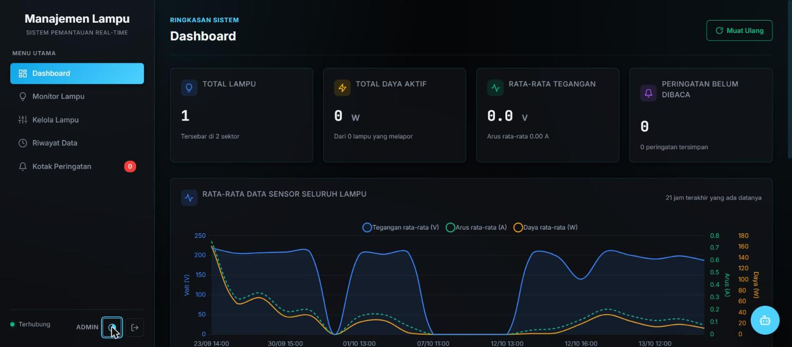
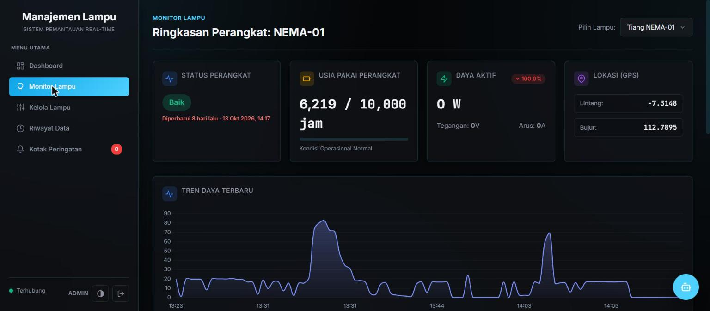
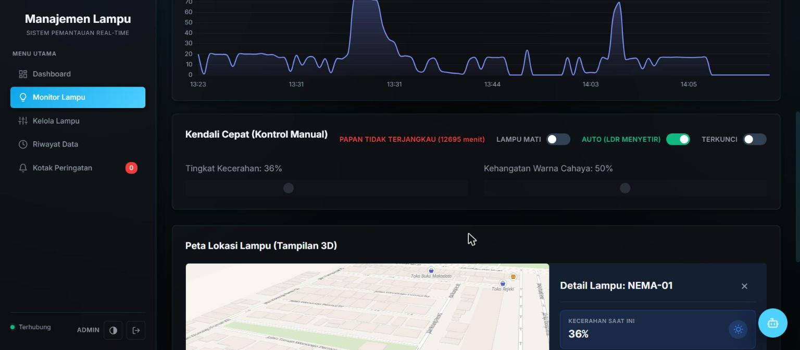
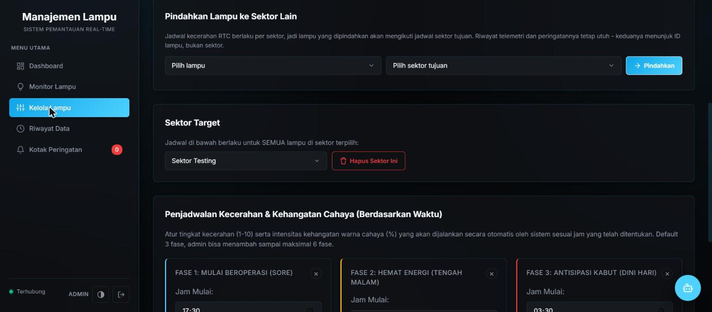
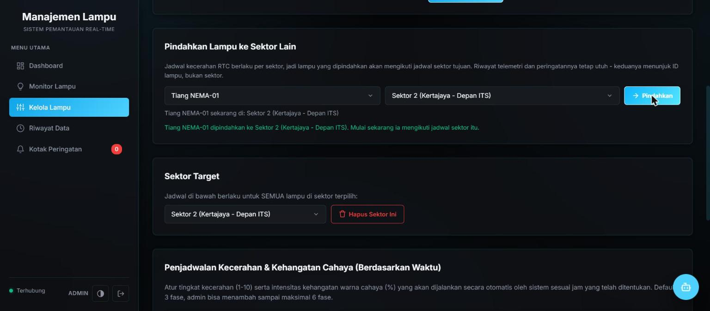
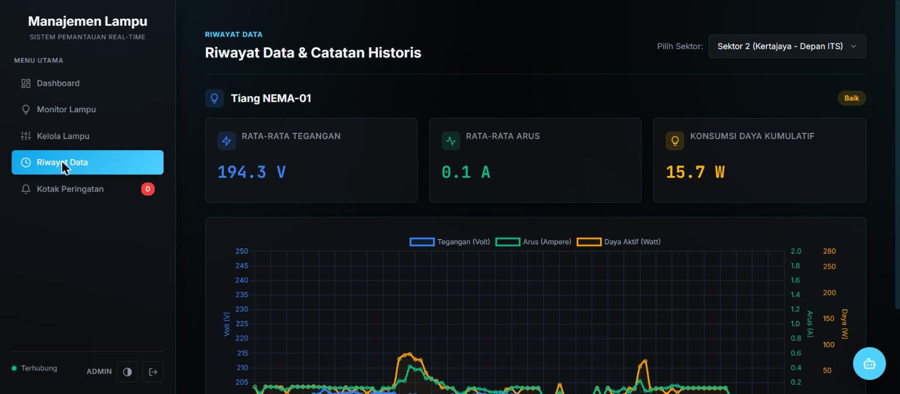
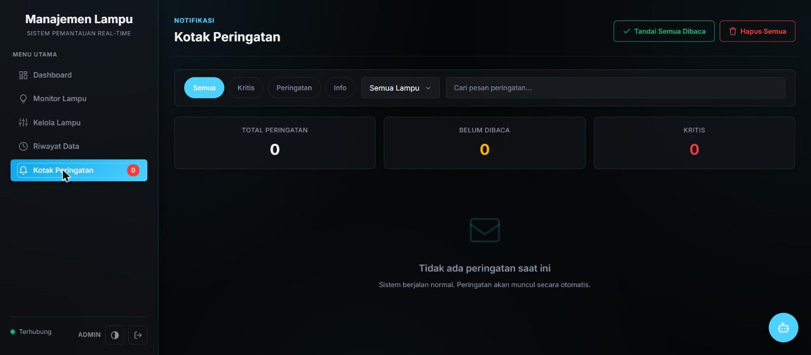
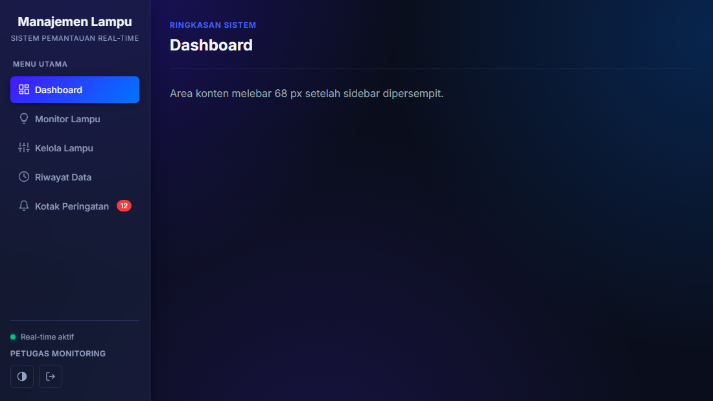

# 6. Dashboard

Frontend statis tanpa framework: satu `index.html` berisi lima halaman,
`script.js` 3.946 baris, dan `style.css` 3.161 baris. Chart.js dan MapLibre GL
4.7.1 dimuat dari CDN.

Alamat backend disusun dari hostname halaman:

```js
const API_BASE_URL      = `${_API_PROTOCOL}//${location.hostname}:8000`;
const TELEMETRY_WS_URL  = `${_WS_PROTOCOL}//${location.hostname}:8000/ws/telemetry`;
```

Skema URL mengikuti protokol halaman, jadi halaman yang dilayani lewat HTTPS
memakai `wss://` tanpa penyesuaian manual.

## 6.1 Halaman

### Dashboard



Agregat seluruh sistem dari `GET /api/system-overview`: jumlah lampu per status
kesehatan, sebaran per sektor, grafik rata-rata telemetri, dan ringkasan AI
opsional.

### Monitor Lampu



Peta MapLibre GL dengan satu marker per lampu, daftar lampu per sektor, dan panel
Kendali Cepat.



Panel ini memuat toggle relai, toggle mode otomatis, slider kecerahan, dan
indikator jangkauan board.

### Kelola Lampu



Tiga formulir, semuanya admin-only: membuat sektor, mendaftarkan lampu, dan
memindahkan lampu ke sektor lain. Halaman ini juga memuat editor jadwal
fase per sektor dan penghapusan sektor.



Pemindahan `NEMA-01` ke Sektor 2 (Kertajaya, Depan ITS) diuji langsung pada
sistem yang berjalan. Halaman Riwayat Data ikut berubah tanpa reload.

### Riwayat Data



Grafik deret waktu per lampu dari `GET /api/telemetry-history`, ringkasan
pembacaan terakhir, dan analisis AI per lampu.

### Kotak Peringatan



Daftar peringatan dari `GET /api/alerts-history`, dengan flag terbaca dan
penghapusan per item atau seluruhnya.

### Pengaturan Akun

Terbuka untuk kedua role. Memuat identitas akun yang sedang login (username,
role, ringkasan hak akses) dan formulir ganti password.

Formulirnya meminta password lama, password baru, dan ulangannya. Panjang
minimal 8 karakter dicek di browser dan sekali lagi di
`routes_auth.change_password()`; yang mengikat adalah yang di server.

Sesudah password berganti, pesan hasilnya menyebutkan berapa sesi lain yang
ikut dicabut, sehingga pemilik akun tahu perangkat lain harus login ulang.

## 6.2 Toggle mengikuti status dari board

`renderRelayToggle()` dan `renderAutoToggle()` membaca `relay` dan `auto` dari
telemetri, dengan `devices.relay_on` dan `devices.auto_mode` dari database
sebagai sumber saat halaman baru dimuat.

Dashboard membedakan "tidak dilaporkan" dari "mati" lewat `undefined`. Lampu
yang belum pernah melapor tidak menampilkan posisi toggle yang mengada-ada.

Slider kecerahan mati sendiri selama mode otomatis menyala, karena board akan
menolak permintaan dim pada keadaan itu. Board tidak bergantung pada perilaku
UI ini, dan menolaknya sendiri.

## 6.3 Indikator jangkauan board

`renderLinkStatus()` mengukur umur telemetri terakhir dan menuliskannya di
panel Kendali Cepat. Tick tiap 5 detik.

| Umur telemetri | Tampilan |
|---|---|
| Di bawah 2,5 menit | Normal |
| 2,5 sampai 5 menit | Peringatan, dua laporan terlewat |
| 5 menit ke atas | Merah, board dianggap tidak terjangkau |

Ambang ini sengaja berbeda dari `STALE_WARNING_MS` (15 menit) di halaman
Monitor. Ambang 15 menit terhadap laporan tiap 60 detik berarti board yang
sudah padam sepuluh menit masih tampil sehat, dan operator yang menekan tombol
tidak tahu bahwa perintahnya tidak akan sampai ke mana-mana.

Padam yang teramati selama pengujian: 4,5 menit dan lebih dari 10 menit,
keduanya pulih sendiri tanpa campur tangan.

## 6.4 Tema

Dua tema, Aurora (gelap kebiruan) dan Onyx (gelap netral). Tombol pemindahnya
ada di footer sidebar dan di layar login. Pilihannya disimpan di
`localStorage`.

## 6.5 Revisi sidebar



Sidebar dipersempit dari 300 px ke 232 px, dan area konten dapat 68 px
tambahan. Tabel Riwayat Data dan grid kartu Monitor Lampu yang paling terasa.

Dua elemen sempat menghalangi penyempitan sidebar:

**Footer.** Indikator koneksi, badge peran, dan dua tombol ikon 36 px semula
berjejer dalam satu baris. Teks "PETUGAS MONITORING" butuh sekitar 165 px pada
12 px uppercase, sedangkan satu baris bersama dua tombol di lebar 232 px hanya
menyisakan 112 px. Footer sekarang tersusun sebagai kolom dan badge peran
mendapat barisnya sendiri.

**Label menu terpanjang.** "Kotak Peringatan" berdampingan dengan badge jumlah
peringatan. Pada lebar baru dengan badge ukuran lama, labelnya membungkus jadi
dua baris begitu angkanya dua digit. Badge dirapatkan ke `padding: 1px 6px` dan
11 px, dan `.nav-label` dikunci `white-space: nowrap`.

Blok `@media (max-width: 768px)` mengembalikan footer ke satu baris, karena di
layar sempit sidebar memakai lebar penuh dan pemisahan baris itu tidak
diperlukan.

## 6.6 Pengujian

`npx vitest run` di `Dashboard_Monitoring/` menjalankan 14 tes fungsi murni di
`tests/pure-functions.test.js`.
