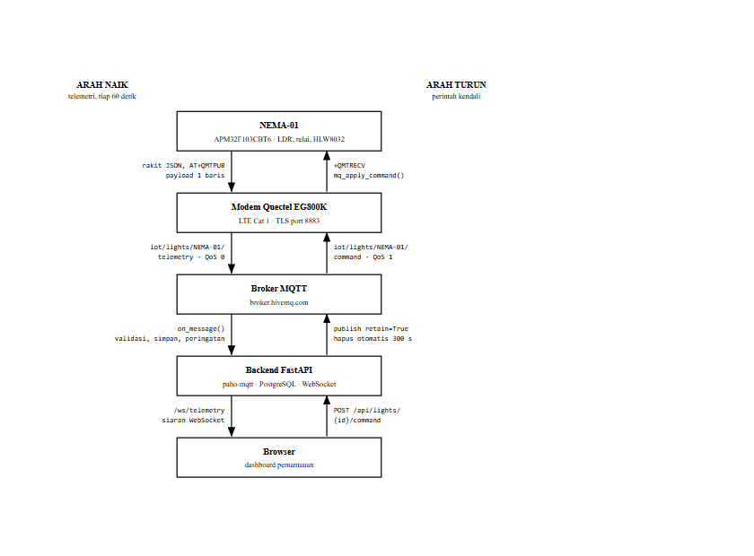

# Pengantar

Dokumentasi teknis untuk controller lampu jalan NEMA berbasis APM32F103CBT6 dan
dashboard pemantauannya. Satu board terpasang dan diuji sampai tulisan ini
dibuat: `NEMA-01`.

## Daftar isi

| Berkas | Isi |
|---|---|
| [01-arsitektur.md](01-arsitektur.md) | Komponen, dua arah aliran data, dan apa yang bisa gagal sendiri-sendiri |
| [02-firmware-nema.md](02-firmware-nema.md) | Board NEMA: peta pin, periferal, konsol UART, state machine MQTT |
| [03-protokol-mqtt.md](03-protokol-mqtt.md) | Topik, bentuk payload, QoS, retained message dan umurnya |
| [04-backend-api.md](04-backend-api.md) | Modul FastAPI, seluruh endpoint, autentikasi, rate limit |
| [05-basis-data.md](05-basis-data.md) | Tabel PostgreSQL, kolom, dan alasan di balik beberapa pilihannya |
| [06-dashboard.md](06-dashboard.md) | Lima halaman dashboard, kendali, indikator sambungan |
| [07-instalasi.md](07-instalasi.md) | Memasang dan menjalankan di Windows tanpa Docker |
| [08-operasi-dan-diagnosis.md](08-operasi-dan-diagnosis.md) | Tool periksa, gejala yang pernah muncul, dan sebabnya |
| [09-keamanan.md](09-keamanan.md) | Yang sudah ditutup, dan yang masih terbuka sebelum pemasangan nyata |
| [10-catatan-perubahan.md](10-catatan-perubahan.md) | Perubahan yang dikerjakan pada putaran terakhir |

## Gambar

Berkas gambar ada di [`gambar/`](gambar). Tangkapan layar diambil dari dashboard
yang berjalan, bukan mock-up.

| Berkas | Isi |
|---|---|
| `00-arsitektur.svg`, `00-arsitektur.png` | Diagram arsitektur dan dua arah aliran data |
| `01-dashboard.jpg` | Halaman Dashboard, ringkasan seluruh sistem |
| `02-monitor-ringkasan.jpg` | Halaman Monitor Lampu |
| `03-kendali-cepat.jpg` | Panel Kendali Cepat dengan indikator jangkauan board |
| `04-kelola-pindah-sektor.jpg` | Formulir pemindahan lampu antar sektor |
| `05-pindah-berhasil.jpg` | Hasil pemindahan `NEMA-01` ke Sektor 2 |
| `06-riwayat-data.jpg` | Halaman Riwayat Data |
| `07-kotak-peringatan.jpg` | Kotak Peringatan |
| `08-sidebar-ringkas.png` | Sidebar setelah dipersempit dari 300 px ke 232 px |
| `10-foto-papan.jpg` | Controller di soket NEMA, tersambung ke luminaire yang menyala |
| `11-wiring.png` | Wiring soket NEMA tujuh pin, acuan umum |
| `13-swagger.png` | Swagger UI di `http://localhost:8000/docs`, 21 endpoint |

## Gambar yang belum ada

Satu berkas berikut dirujuk dari dokumen tetapi belum dibuat. Letakkan di
`gambar/` dengan nama persis seperti ini supaya tautannya langsung hidup.

| Nama berkas | Isi yang diharapkan |
|---|---|
| `14-konsol-uart.png` | Tangkapan layar konsol serial saat perintah `s` dijalankan |
